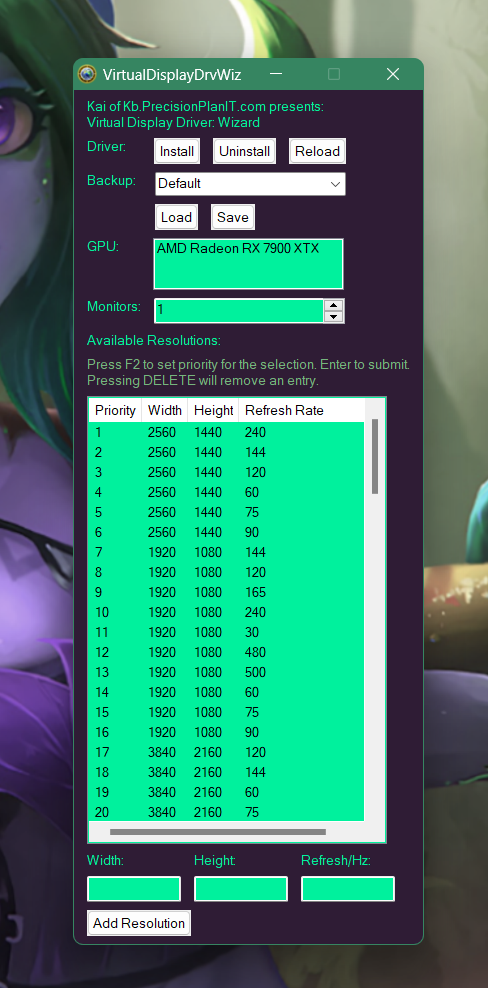

#  Display Wizard

Manages a virtual display driver on Windows: installs, removes and reloads the driver and configures virtual monitors. A Go backend (`dwiz`, a CLI and a loopback HTTP API) with a React UI in an Electron shell.

<!-- sf:project:start -->
<!-- sf:project:end -->
<!-- sf:badges:start -->
<!-- sf:badges:end -->

---

> [!WARNING]
> **This is the Go port, in development and not close to GA: only its UI is functional.** The working version is v0.6.x, written in AutoHotkey, on the [`v0.6.x-autohotkey`](https://gitlab.prplanit.com/PrPlanIT/DisplayWizard/-/tree/v0.6.x-autohotkey) branch — [download it from Releases](https://github.com/PrPlanIT/DisplayWizard/releases). There is no ETA for the Go port.

### Features:

|                                   |                                                                                     |
| --------------------------------- | ----------------------------------------------------------------------------------- |
| **Driver lifecycle**              | Install, remove and reload the virtual display driver                               |
| **Virtual monitors**              | Configure the monitors the driver provides                                          |
| **CLI and API**                   | `dwiz` runs every operation from a command line, or serves them on `127.0.0.1:5757` |
| **Per-operation elevation**       | Runs as the invoking user; only driver install, remove and reload ask for UAC      |

### Documentation

| Guide | Covers |
|-------|--------|
| [Design](docs/design.md) | Architecture, direction and phases, security invariants |

---

## Contributing

- Fork the repository
- Submit Pull Requests / Merge Requests
- [File issues](https://github.com/PrPlanIT/DisplayWizard/issues/new) with your Windows version, driver version, and the command involved

## Credits

* **VirtualDrivers** — the HDR-capable [Virtual Display Driver](https://github.com/VirtualDrivers/Virtual-Display-Driver) this tool is built around
* **Nefarius** — [nefcon](https://github.com/nefarius/nefcon), which handles driver installation
* **LizardByte** — [Sunshine](https://github.com/LizardByte/Sunshine), the motivation for the CLI and Sunshine integration

## License

Display Wizard is distributed under the [AGPL-3.0](LICENSE) license.
