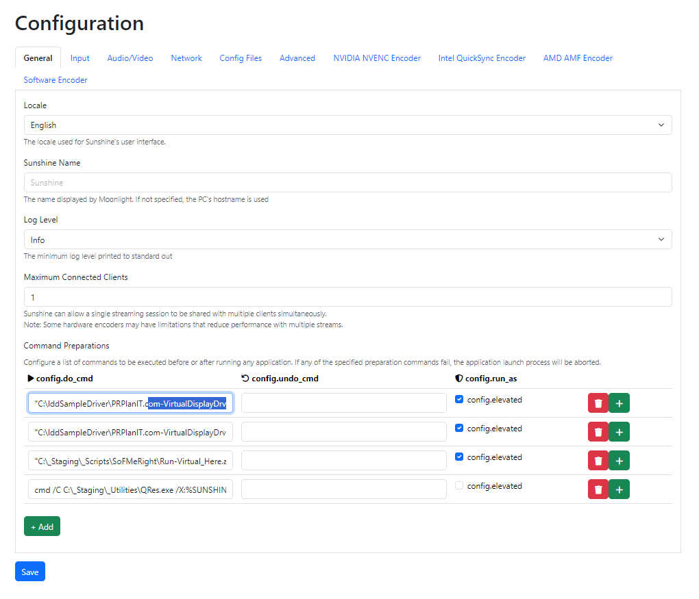

# Sunshine

Every client that connects through [Sunshine](https://github.com/LizardByte/Sunshine) can add its requested resolution and switch to it automatically.



The important command, and the first one for this tool:

```bat
C:\IddSampleDriver\SunshineIntegration.bat %SUNSHINE_CLIENT_WIDTH% %SUNSHINE_CLIENT_HEIGHT% %SUNSHINE_CLIENT_FPS%
```

The others in the screenshot, in case you are curious:

```bat
"C:\_Staging\_Scripts\SoFMeRight\Run-Virtual_Here.ahk"
cmd /C C:\_Staging\_Utilities\QRes.exe /X:%SUNSHINE_CLIENT_WIDTH% /Y:%SUNSHINE_CLIENT_HEIGHT% /R:%SUNSHINE_CLIENT_FPS%
```

- For some strange reason this can be executed through a `.bat` but not directly from Sunshine. It is not a syntax issue: the `.bat` receives the same syntax.
- Check the `config.elevated` option — admin is needed for driver reloading, and the tool will not run without elevation.
- Point the Sunshine command at `SunshineIntegration.bat`, then run QRes to set the resolution, and every client will add any resolution it requests. There are [FOSS HDR togglers](https://github.com/Nonary/AutoHDRSwitch) available as well.
